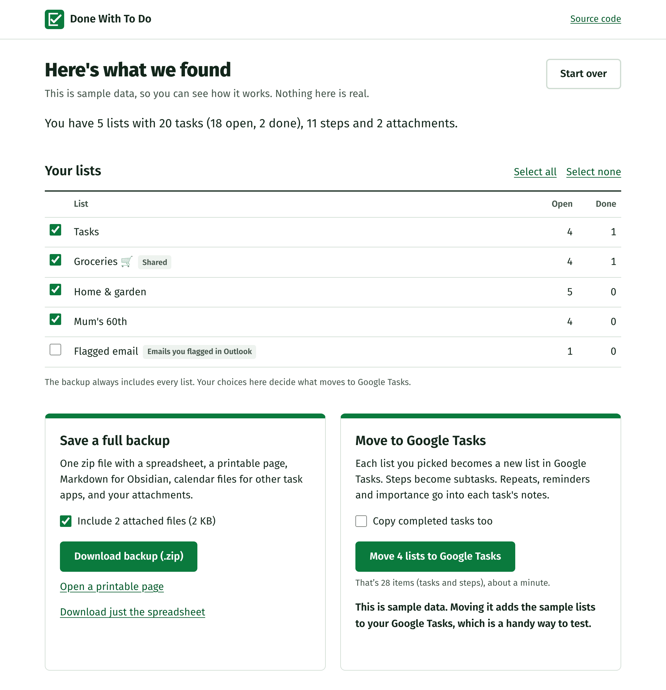

# Done With To Do

**Microsoft To Do shuts down on June 30, 2027. Take your lists with you.**

Done With To Do is a free web page that copies your Microsoft To Do lists into Google Tasks, or saves them as a full backup you can open anywhere. It runs entirely in your browser: there's no server, no account to create and no tracking.

**Use it here:** https://lifeboatlabs.github.io/done-with-todo/



## What it does

1. **Sign in with Microsoft.** It asks for read-only access, so it can't change or delete anything in To Do. (Attached files need one extra permission; see below.)
2. **Choose your lists.** You see every list and task it found.
3. **Save or move them.**
    - **Full backup (.zip):** a spreadsheet (CSV), a printable page, Markdown files for Obsidian (Tasks plugin format), calendar files (.ics) for Thunderbird, Nextcloud, Tasks.org and others, a JSON file with everything, and the files attached to your tasks.
    - **Google Tasks:** each list becomes a Google Tasks list. Steps become subtasks, and notes, due dates and completed tasks come too. This opens to everyone once Google finishes reviewing the app; until then it stays hidden, so the page only shows what works today.

## What moves where

| To Do has | Backup | Google Tasks |
| --- | --- | --- |
| Lists and tasks | Yes | Yes |
| Steps | Yes | Yes, as subtasks |
| Notes | Yes | Yes |
| Due dates | Yes | Yes |
| Completed tasks | Yes | Optional |
| Repeats | Yes | Written into the task's notes, because Google Tasks can't import repeats |
| Reminders | Yes | Written into the task's notes |
| Importance, categories, links | Yes | Written into the task's notes |
| Attached files | Yes, in the zip (see below) | Names written into the notes |
| My Day, list groups | No, because Microsoft doesn't share these with other apps | No |

On personal accounts, Microsoft only shares the files attached to tasks with apps that also have permission to change tasks (`Tasks.ReadWrite`). So the page starts read-only, and if it finds files Microsoft held back, it offers an **Include attached files** button that signs you in again with that permission. The page still only reads: every request it sends to Microsoft is a `GET`, and the tests check that. If you'd rather not allow it, the backup still includes everything else and lists the tasks whose files you should save by hand.

## Privacy

- Your tasks go straight from Microsoft to your browser and, if you choose, straight to Google.
- Sign-in tokens stay in the page's memory and disappear when you close the tab.
- The page's Content Security Policy only lets it connect to Microsoft and Google.
- No cookies, analytics or ads. Read the full [privacy page](https://lifeboatlabs.github.io/done-with-todo/privacy.html).

## Support the project

If this saved you an afternoon of retyping, **star this repository** so other people can find it. Tips are welcome too: [leave a tip](https://lifeboatlabs.github.io/tip/) in SOL, ETH or USDC.

## Run your own copy

The site is plain HTML, CSS and JavaScript, with no build step and no dependencies.

1. Fork this repository and turn on GitHub Pages (Settings, Pages, deploy from the `main` branch).
2. In Microsoft Entra, register an app with "Accounts in any organizational directory and personal Microsoft accounts". Add your site address as a **Single-page application** redirect URI and add the delegated permission `Tasks.Read`.
3. In Google Cloud, enable the Google Tasks API, configure the Google Auth Platform, and create a **Web application** OAuth client with your site's origin as an authorized JavaScript origin.
4. Put both client IDs in `config.js`. Until the Microsoft ID is set, the page shows a yellow setup box with the exact values to register.

## Tests

```
node tests/unit.test.js
python3 tests/e2e.py
```

The unit tests need nothing but Node. They cover the backup formats, the zip writer, Microsoft sign-in (PKCE) and paging, attachments Microsoft holds back, and the Google Tasks transfer (ordering, subtasks, rate limits and resuming after a pause).

The browser tests need Python Playwright. They drive the real page in Chrome against fake Microsoft and Google servers: sign-in, reading 124 tasks across pages, the backup zip, the Google Tasks move, the attached-files permission, the page on an iPhone, and a check that every request to Microsoft is a read.

## Licence

MIT. The Fira Sans font is under the SIL Open Font License (see `FONT-LICENSE.txt`).

Done With To Do isn't made by, or affiliated with, Microsoft or Google. Microsoft To Do is a trademark of Microsoft.

## Lifeboat Labs

Done With To Do is made by [Lifeboat Labs](https://lifeboatlabs.github.io/): free tools for when the apps you rely on shut down. Know an app that's closing? [Suggest it](https://github.com/LifeboatLabs/lifeboatlabs.github.io/issues/new?title=Shutting%20down%3A%20). For new tools and updates, follow [Lifeboat Labs on X](https://x.com/Lifeboat_labs).
